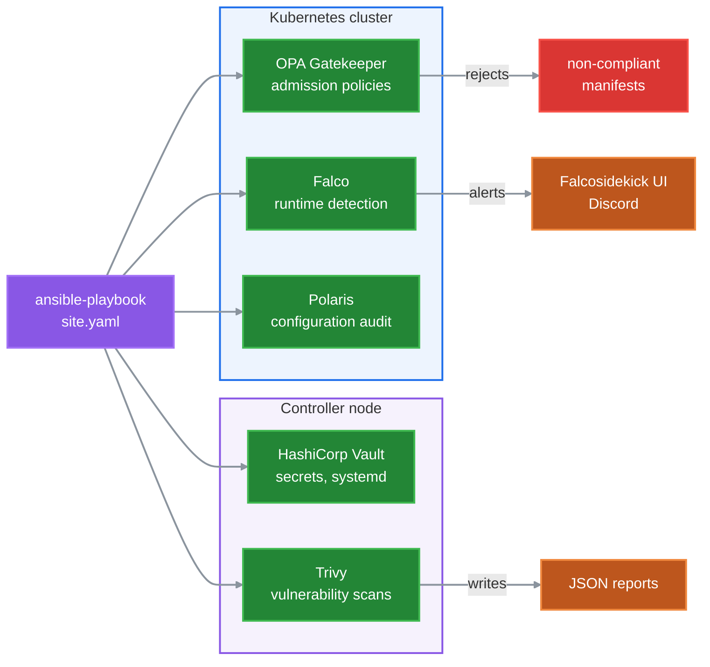

# Kubernetes Security Stack with Ansible


One Ansible playbook that adds five security layers to an existing Kubernetes cluster: admission policies, runtime threat detection, configuration audit, vulnerability scanning and secrets management. Each layer is a role with its own tag, so it can be deployed or re-run on its own.

## Architecture



Three layers run inside the cluster; Vault and Trivy run on the controller node itself.

## What it deploys

| Layer | Tool | What the role does | Tag |
|---|---|---|---|
| Admission control | OPA Gatekeeper v3.14.2 | Installs Gatekeeper and four policies, then proves each policy with a manifest that must be rejected | `gatekeeper` |
| Runtime detection | Falco + Falcosidekick | Installs Falco with Helm. Alerts go to the Falcosidekick UI, and to Discord when a webhook is given | `falco` |
| Configuration audit | Polaris | Installs the Polaris dashboard with Helm and scores the cluster against best practices | `polaris` |
| Vulnerability scanning | Trivy | Scans a container image, and optionally a project and Kubernetes manifests, for HIGH and CRITICAL issues | `trivy` |
| Secrets management | HashiCorp Vault 1.15.4 | Runs Vault as a systemd service on the controller with Raft storage, then initializes and unseals it | `vault` |
| Tooling | | Installs kubectl (snap, if missing), the Python Kubernetes client, Docker and Java 17 on the machine running Ansible, adds the user to the `docker` group, and creates the `prod`, `monitoring`, `security` and `logging` namespaces | `prerequisites` |

## Gatekeeper policies

| Policy | Applies to | Proof manifest (must be rejected) |
|---|---|---|
| No `NodePort` Services | all namespaces except the system ones | Service of type NodePort in `prod` |
| No `:latest` image tags | all namespaces except the system ones | Deployment using `nginx:latest` |
| No privileged containers | all namespaces except the system ones | Deployment with `privileged: true` |
| CPU and memory limits required | Pods in `prod` | Pod without limits |

The namespaces `kube-system`, `kube-flannel`, `gatekeeper-system`, `falco` and `polaris` are excluded from the three cluster-wide policies, because the components they run (kube-proxy, Flannel, Gatekeeper, Falco, Polaris) need privileged containers or other exceptions. The policies check the main containers of Pods and workload templates, not init containers, and an image with no tag (`nginx`) is not caught by the `:latest` policy.

The playbook applies every proof manifest and fails if Gatekeeper accepts it, so a successful run shows the policies are enforced.

## Requirements

- **Cluster:** a running Kubernetes cluster, for example one built with [ansible-kubeadm-cluster](https://github.com/raslenraslen/ansible-kubeadm-cluster).
- **Where to run:** on the controller node, as a user with a working `~/.kube/config` and passwordless `sudo`. Every play except Vault targets `localhost`.
- **OS:** Ubuntu 22.04 on amd64. The roles install Python packages with system-wide `pip3`, which Ubuntu 23.04 and later block (PEP 668).
- **Helm 3** installed on the controller (Falco and Polaris are deployed with Helm).
- **Ansible** with the `kubernetes.core` and `community.general` collections (see Quick start).

## Quick start

```bash
git clone https://github.com/raslenraslen/ansible-k8s-security-stack.git
cd ansible-k8s-security-stack/ansible-security
ansible-galaxy collection install -r requirements.yml
```

Set the controller IP, SSH user and SSH key in `inventory.ini`. The Vault play connects to the controller over SSH, so the key must give access to the controller itself. Then run everything:

```bash
ansible-playbook -i inventory.ini site.yaml
```

To send Falco alerts to Discord, pass the webhook at run time. Never commit it.

```bash
ansible-playbook -i inventory.ini site.yaml -e discord_webhook_url=<webhook URL>
```

To deploy one layer only, use its tag, for example `--tags gatekeeper`. The tags are `prerequisites`, `vault`, `gatekeeper`, `falco`, `polaris` and `trivy`; run `prerequisites` once before the others.

## After the run

| Tool | Access |
|---|---|
| Vault | `http://<controller IP>:8200/ui`. The unseal key and root token are saved in `ansible-security/.vault-init.json` (mode 0600, git-ignored) |
| Falcosidekick UI | `http://<falcosidekick_ui_ip>:2802/dashboard/`, login `admin` / `admin` (chart default) |
| Polaris | `http://<controller IP>:8080/` |
| Trivy | JSON reports in `~/trivy-reports/` |

**Test Falco:** open a shell in any pod with `kubectl exec -it <pod> -n <namespace> -- sh`. The built-in rule "Terminal shell in container" raises an alert in the Falcosidekick UI, and on Discord if a webhook is set.

**Vault after a restart** comes back sealed. Unseal it with the saved key:

```bash
ansible-playbook -i inventory.ini site.yaml --tags vault -e unseal_key_extra_var=<unseal key>
```

## Configuration

Each role reads its settings from `roles/<role>/defaults/main.yml`. The main ones:

| Variable | Default | Purpose |
|---|---|---|
| `discord_webhook_url` | empty | Discord webhook for Falco alerts. Empty disables Discord |
| `falcosidekick_ui_ip` | `192.168.216.142` | IP printed in the Falcosidekick UI link |
| `gatekeeper_version` | `v3.14.2` | Gatekeeper release that is installed |
| `test_image` | `nginx:1.20.0` | Image scanned by Trivy |
| `app_deps_target` | empty | Project path for `trivy fs`. Empty skips the scan |
| `k8s_config_target` | empty | Manifest path for `trivy config`. Empty skips the scan |
| `vault_force_reinit` | `false` | `true` wipes all Vault data and initializes a new Vault |
| `polaris_cluster_context` | `kubernetes-admin@kubernetes` | kubeconfig context used by the Polaris port-forward (the kubeadm default) |

## Limitations

This is a lab setup, not a production one:

- **Vault** is a single node with TLS disabled and a single unseal key.
- **The Falcosidekick and Polaris UIs** are exposed with `kubectl port-forward` on all interfaces, over plain HTTP. They stop when the port-forward process ends, and a re-run does not restart them while the PID file in `/tmp` exists.
- **The Falcosidekick UI** keeps its history in memory (Redis without a volume), so a Redis restart clears it.
